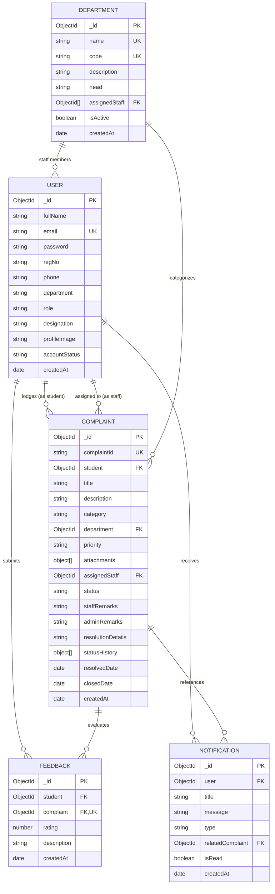

# CAMPUSCARE – DATABASE SCHEMA SPECIFICATION
## VFSTR HYDERABAD CAMPUS COMPLAINT MANAGEMENT SYSTEM

---

## 1. Entity-Relationship Overview

The database design uses **Mongoose ODM** over **MongoDB Atlas / Local MongoDB**. The five principal collections and their references are illustrated below:



---

## 2. Detailed Collection Schemas

### 2.1 `User` Collection (`users`)

Stores account records for Students, Faculty/Staff, and Administrators.

| Field | Type | Validation / Constraints | Default Value | Description |
| :--- | :--- | :--- | :--- | :--- |
| `_id` | `ObjectId` | Primary Key, Auto-generated | `ObjectId()` | Unique record identifier |
| `fullName` | `String` | Required, Trimmed, Max 100 chars | None | User's full name |
| `email` | `String` | Required, Unique, Lowercase, Regex Email | None | College or official email |
| `password` | `String` | Required, Min 6 chars, `select: false` | None | Bcrypt hashed password |
| `regNo` | `String` | Optional, Trimmed, Uppercase | `""` | Student Roll / Registration number |
| `phone` | `String` | Optional, Trimmed | `""` | Mobile telephone number |
| `department`| `String` | Optional, Trimmed | `'General'` | Academic or work department |
| `role` | `String` | Enum: `['STUDENT', 'STAFF', 'ADMIN']` | `'STUDENT'` | Access control role |
| `designation`| `String` | Optional, Trimmed | `'Student'` | Title (e.g. Assistant Professor, Warden) |
| `profileImage`| `String` | URL path | `'/images/default-avatar.svg'` | Uploaded profile image path |
| `accountStatus`| `String` | Enum: `['ACTIVE', 'INACTIVE', 'SUSPENDED']`| `'ACTIVE'` | Account standing |
| `resetPasswordToken`| `String` | Hash string | `null` | Token for password recovery |
| `resetPasswordExpire`| `Date` | Timestamp | `null` | Token expiration date (30 mins) |
| `createdAt` | `Date` | Mongoose Timestamp | `Date.now()` | Account registration date |
| `updatedAt` | `Date` | Mongoose Timestamp | `Date.now()` | Last modification date |

#### Indexes:
- `{ email: 1 }` (Unique index)
- `{ regNo: 1 }` (Sparse index)

---

### 2.2 `Department` Collection (`departments`)

Defines campus departments and administrative resolution centers.

| Field | Type | Validation / Constraints | Default Value | Description |
| :--- | :--- | :--- | :--- | :--- |
| `_id` | `ObjectId` | Primary Key | `ObjectId()` | Department ID |
| `name` | `String` | Required, Unique, Max 100 chars | None | Full department name |
| `code` | `String` | Required, Unique, Uppercase, Max 10 | None | Short code (e.g., `CSE`, `MAINT`) |
| `description`| `String`| Trimmed | `""` | Scope of grievances handled |
| `head` | `String` | Trimmed | `'Head of Department'`| Name of HOD / Coordinator |
| `assignedStaff`| `[ObjectId]`| Ref: `'User'` | `[]` | Staff members belonging to department |
| `isActive` | `Boolean` | Boolean | `true` | Active status indicator |
| `createdAt` | `Date` | Mongoose Timestamp | `Date.now()` | Created date |

#### Indexes:
- `{ name: 1 }` (Unique)
- `{ code: 1 }` (Unique)

---

### 2.3 `Complaint` Collection (`complaints`)

Master registry for student grievances, attachment metadata, and lifecycle audit history.

| Field | Type | Validation / Constraints | Default Value | Description |
| :--- | :--- | :--- | :--- | :--- |
| `_id` | `ObjectId` | Primary Key | `ObjectId()` | Complaint record ID |
| `complaintId`| `String` | Required, Unique, Indexed | Formatted `CC-YYYY-XXXXX` | Human-readable tracking ID |
| `student` | `ObjectId` | Required, Ref: `'User'`, Indexed | None | Student who filed the complaint |
| `title` | `String` | Required, Min 5, Max 200 chars | None | Brief subject line |
| `description`| `String` | Required, Min 10 chars | None | Detailed grievance description |
| `category` | `String` | Required, Valid Enum | None | Academic, Hostel, Lab, etc. |
| `department` | `ObjectId` | Ref: `'Department'`, Indexed | `null` | Concerned campus department |
| `priority` | `String` | Enum: `['LOW', 'MEDIUM', 'HIGH', 'URGENT']` | `'MEDIUM'` | Urgency level |
| `attachments` | `[Subdoc]` | Schema: filename, path, mimetype, size | `[]` | Uploaded supporting files |
| `assignedStaff`| `ObjectId`| Ref: `'User'`, Indexed | `null` | Faculty/Staff tasked with redressal |
| `status` | `String` | Enum: `['SUBMITTED', 'UNDER REVIEW', 'ASSIGNED', 'IN PROGRESS', 'RESOLVED', 'CLOSED', 'REOPENED']` | `'SUBMITTED'` | Current pipeline status |
| `staffRemarks` | `String` | Trimmed | `""` | Notes added by assigned staff |
| `adminRemarks` | `String` | Trimmed | `""` | Directives added by administrator |
| `resolutionDetails`| `String`| Trimmed | `""` | Technical details of the resolution |
| `statusHistory` | `[Subdoc]` | Schema: status, updatedBy (ref User), remarks, timestamp | `[]` | Audited timeline entries |
| `resolvedDate` | `Date` | Timestamp | `null` | When status transitioned to RESOLVED |
| `closedDate` | `Date` | Timestamp | `null` | When status transitioned to CLOSED |
| `createdAt` | `Date` | Timestamp | `Date.now()` | Lodged timestamp |

#### Status History Subdocument Schema:
```json
{
  "status": "IN PROGRESS",
  "updatedBy": "ObjectId('...')",
  "remarks": "Technician inspecting equipment on site",
  "timestamp": "2026-11-04T12:00:00.000Z"
}
```

#### Compound Indexes:
- `{ complaintId: 1 }` (Unique)
- `{ status: 1, department: 1, priority: 1, createdAt: -1 }` (High-speed multi-filter queries)
- `{ student: 1, createdAt: -1 }` (Student personal complaint queries)
- `{ assignedStaff: 1, status: 1 }` (Staff queue lookups)

---

### 2.4 `Feedback` Collection (`feedbacks`)

Maintains quality ratings and feedback from students following complaint resolution.

| Field | Type | Validation / Constraints | Description |
| :--- | :--- | :--- | :--- |
| `_id` | `ObjectId` | Primary Key | Record ID |
| `student` | `ObjectId` | Required, Ref: `'User'` | Student author |
| `complaint` | `ObjectId` | Required, Unique, Ref: `'Complaint'` | Target resolved complaint |
| `rating` | `Number` | Required, Integer 1 to 5 | Star rating |
| `description` | `String` | Required, Min 5, Max 1000 chars | Qualitative feedback text |
| `createdAt` | `Date` | Timestamp | Feedback date |

#### Indexes:
- `{ complaint: 1 }` (Unique index guarantees only one review per complaint)

---

### 2.5 `Notification` Collection (`notifications`)

Stores user-specific alert triggers and status change notifications.

| Field | Type | Validation / Constraints | Default Value | Description |
| :--- | :--- | :--- | :--- | :--- |
| `_id` | `ObjectId` | Primary Key | `ObjectId()` | Notification ID |
| `user` | `ObjectId` | Required, Ref: `'User'`, Indexed | None | Target recipient user |
| `title` | `String` | Required, Trimmed | None | Notification subject |
| `message` | `String` | Required, Trimmed | None | Human-readable alert body |
| `type` | `String` | Enum: `['INFO', 'SUCCESS', 'WARNING', 'ALERT']` | `'INFO'` | Color/severity coding |
| `relatedComplaint`| `ObjectId`| Ref: `'Complaint'` | `null` | Associated complaint link |
| `isRead` | `Boolean` | Indexed | `false` | Read receipt flag |
| `createdAt` | `Date` | Timestamp | `Date.now()` | Trigger timestamp |

#### Indexes:
- `{ user: 1, isRead: 1, createdAt: -1 }` (Fast unread counter and bell query)

