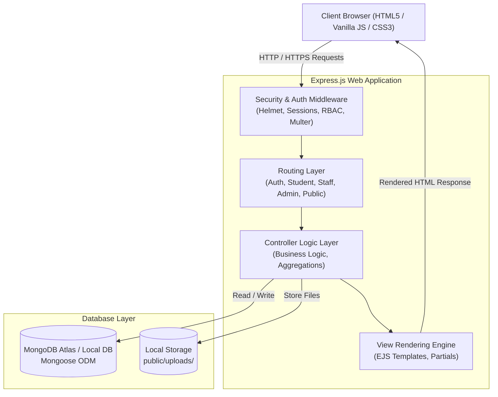
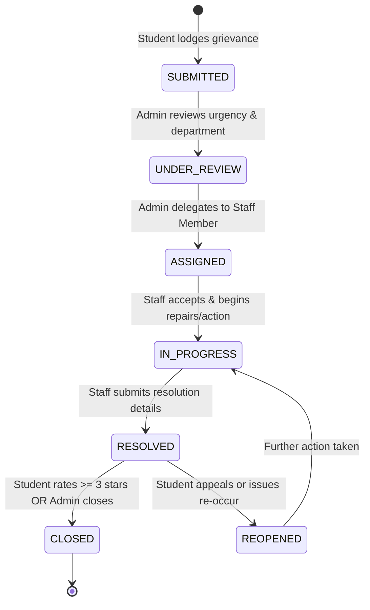

# CAMPUSCARE – PROJECT SPECIFICATION & SYSTEM DOCUMENTATION
## VFSTR HYDERABAD CAMPUS COMPLAINT MANAGEMENT SYSTEM

---

## 1. Project Synopsis & Objectives

### 1.1 Introduction
In modern academic institutions like **Vignan's Foundation for Science, Technology & Research (VFSTR) Hyderabad Campus**, students and faculty frequently encounter operational, infrastructural, and academic hurdles. Traditional paper-based complaint registers or informal messaging systems lead to lost grievances, lack of accountability, no time tracking, and zero visibility into resolution status.

**CampusCare** is a full-stack, enterprise-grade web application engineered to digitize, monitor, and resolve student grievances through an audited, multi-tier redressal framework.

### 1.2 Primary Objectives
1. **Centralized Grievance Registry**: Provide students with an intuitive portal to register complaints across diverse categories (Academics, Laboratories, Hostels, Transport, Maintenance, Examination).
2. **Transparent Lifecycle Tracking**: Maintain complete auditability through a 6-stage lifecycle (`SUBMITTED` ➔ `UNDER REVIEW` ➔ `ASSIGNED` ➔ `IN PROGRESS` ➔ `RESOLVED` ➔ `CLOSED`).
3. **Role-Based Segregation**: Ensure strict isolation between Student, Staff, and Administrative capabilities.
4. **Accountability & Quality Assurance**: Require staff to submit formal resolution remarks and enable students to rate outcomes on a 1–5 star scale.
5. **Data-Driven Administration**: Furnish campus leadership with real-time analytics, department performance metrics, and CSV reporting capabilities.

---

## 2. System Architecture

CampusCare follows the classic **Model-View-Controller (MVC)** architectural paradigm using Node.js, Express.js, and MongoDB:

---

## 3. Complaint Redressal Workflow Lifecycle

Every grievance progresses through a structured finite state machine:

### Lifecycle Stage Definitions:
1. **SUBMITTED**: Grievance registered by student with title, description, category, and optional attachments.
2. **UNDER REVIEW**: Administrator screens the grievance, assesses priority (`LOW`, `MEDIUM`, `HIGH`, `URGENT`), and ensures proper departmental routing.
3. **ASSIGNED**: Designated faculty member, lab in-charge, or maintenance supervisor is tasked with the resolution.
4. **IN PROGRESS**: Staff member acknowledges assignment, visits the location, and updates inspection remarks.
5. **RESOLVED**: Work is concluded. Staff enters technical resolution details and registers resolution timestamp.
6. **CLOSED**: Grievance is formally marked complete upon student feedback submission or administrative sign-off.
7. **REOPENED**: Permitted if resolution is deficient upon review.

---

## 4. Detailed Module Specifications

### 4.1 Authentication & Authorization Module
- **Public Registration**: Strictly restricted to students. Collects registration number, department, email, phone, and hashed password.
- **Administrative Provisioning**: Staff accounts are securely created by administrators with department associations.
- **Password Security**: Bcrypt.js with 10 salt rounds and pre-save Mongoose hooks.
- **Session Management**: Session store backed by `connect-mongo` with 24-hour cookie lifecycle and HTTP-only flags.
- **Role Guards**: Express middleware (`ensureAuthenticated`, `authorizeRoles`) blocks unauthorized cross-tier access.

### 4.2 Student Module
- **Grievance Lodgement**: Rich form with category selection, urgency level, and Multer file upload (JPG, PNG, PDF up to 5MB).
- **Complaint Tracking**: List and details view showing exact current stage, assigned officer, and historical timeline.
- **Audit History**: Transparent timeline detailing every stage update, date, and remark.
- **Feedback & Rating**: 1 to 5 star rating system with mandatory comments upon resolution. Prevents duplicate feedback.
- **Profile Management**: Update profile picture, contact number, and password.

### 4.3 Staff / Faculty Module
- **Action Queue**: Filtered view displaying only complaints explicitly assigned to the logged-in staff member or department.
- **Progress Updates**: Staff can accept grievances into `IN PROGRESS` and record step-by-step progress remarks.
- **Resolution Reporting**: Formal submission of resolution details that automatically transitions grievance to `RESOLVED`.
- **Direct Student Context**: View student registration number, department, and contact info for prompt coordination.

### 4.4 Administrator Module
- **Analytics Dashboard**: Aggregated metrics using MongoDB `$group`, `$lookup`, and `$unwind` pipelines.
- **Grievance Delegation**: Assign department, assign specific staff member, adjust priority, and append administrative directives.
- **Department Management**: Add and configure academic departments and infrastructure units (CSE, ECE, MAINT, HOSTEL, TRANS).
- **Staff Directory**: Provision new staff accounts and toggle active/inactive status.
- **Student Directory**: Inspect student registry, search by roll number, and toggle active/suspended status.
- **Student Feedback Review**: Monitor departmental satisfaction scores and average ratings.
- **Reports & Exporting**: Stream CSV downloads of master grievance logs and feedback datasets.

### 4.5 File Upload Subsystem
- Powered by `multer` disk storage.
- File filter checks file extension and MIME type (`image/jpeg`, `image/png`, `application/pdf`).
- File size boundary: Max 5MB per attachment, up to 5 attachments per complaint.
- Files stored with sanitized filenames and randomized cryptographic suffixes to avoid naming collisions.

### 4.6 In-App Notification Subsystem
- Database-backed notifications (`Notification` model) linked to specific complaints.
- Automated triggers:
  - When student lodges a grievance ➔ Student & Admins notified.
  - When admin assigns a staff member ➔ Staff & Student notified.
  - When staff updates progress / resolves ➔ Student & Admin notified.
  - When student submits feedback ➔ Assigned Staff notified.
- Unread count badge with live header bell indicator.
- Support for "Mark as Read", "Mark All Read", and "Delete".

---

## 5. Security Architecture

1. **Helmet**: Secures HTTP response headers against clickjacking, MIME sniffing, and cross-site scripting.
2. **CORS**: Enforces approved origin policies.
3. **Rate Limiting**: Protects authentication endpoints (`/auth/*`) against brute-force attacks (max 300 requests per 15 minutes).
4. **Input Validation & Sanitization**: Comprehensive `express-validator` rules validate field lengths, email patterns, and enum boundaries.
5. **NoSQL Injection Defense**: Strict Mongoose schemas with typed fields and query sanitization prevent query injection.
6. **Data Privacy**: Public tracking portal displays grievance progress without exposing student telephone or email addresses.

---

## 6. Academic Viva Presentation Highlights

When demonstrating this project in viva examinations:
1. **Show the 3 Roles**: Log in as Student ➔ lodge grievance with attachment ➔ Log in as Admin ➔ assign staff and elevate priority ➔ Log in as Staff ➔ mark in progress and resolve ➔ Log back in as Student ➔ submit 5-star feedback!
2. **Show Chart.js Visualizations**: In Admin Dashboard, display dynamic department and status breakdown charts powered by MongoDB Aggregations.
3. **Show CSV Export**: In Admin Reports, click "Download Complaints CSV" and inspect the downloaded spreadsheet.
4. **Show Public Tracker**: Log out and access `/track`, entering the generated `CC-2026-XXXX` ID.

